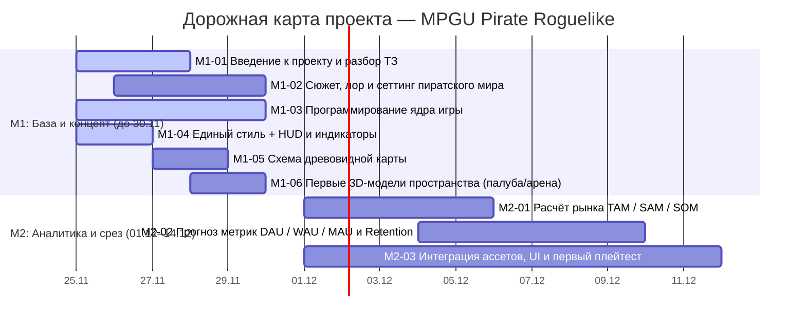

# План проекта — MPGU Pirate Roguelike

> **Проект:** MPGU Pirate Roguelike (3D-рогалик / Dungeon Crawler)  
> **Интерактивная версия для браузера:** откройте [roadmap.html](./roadmap.html) (как открыть и обновить — см. [README.md](./README.md)).

---

## 1. Диаграмма Ганта

---

## 2. Задачи и вехи

| ID | Веха | Задача | Ответственный | Старт | Дедлайн | Статус | Прогресс | Критерий готовности (DoD) |
| :--- | :--- | :--- | :--- | :--- | :--- | :--- | :--- | :--- |
| `M1-01` | M1: База и концепт | Сделать введение к проекту | Нарратив / Текст | 2026-11-25 | 2026-11-28 | В работе | 30% | Готов раздел введения: цель, жанр, УТП, целевая аудитория |
| `M1-02` | M1: База и концепт | Прописать сюжет и лор | Нарратив / Текст | 2026-11-26 | 2026-11-30 | К выполнению | 10% | Завязка, мотивация капитана, сеттинг островов/подземелий и врагов |
| `M1-03` | M1: База и концепт | Программирование ядра игры | Программист | 2026-11-25 | 2026-11-30 | В работе | 50% | Рабочий прототип: перемещение, боёвка (сабля + пистоль), 2 валюты, базовая карта |
| `M1-04` | M1: База и концепт | Единый стиль (мудборд) + HUD и индикаторы | Дизайнер | 2026-11-25 | 2026-11-27 | В работе | 10% | Зафиксирована палитра/стиль, готовы макеты HUD (HP, 5 пуль, 2 валюты, dash) |
| `M1-05` | M1: База и концепт | Схема древовидной карты | Дизайнер | 2026-11-27 | 2026-11-29 | К выполнению | 0% | Прототип экрана карты переходов и иконки узлов (бой, магазин, босс, сундук) |
| `M1-06` | M1: База и концепт | Первые 3D-модели пространства | Дизайнер | 2026-11-28 | 2026-11-30 | К выполнению | 0% | Первые модели палубы корабля-хаба и укрытий для арены (`.glb`/`.tscn`) |
| `M2-01` | M2: Аналитика и срез | Сделать TAM / SAM / SOM | Аналитика / Команда | 2026-12-01 | 2026-12-06 | Бэклог | 0% | Расчёты с источниками по рынку инди-рогаликов (ПК/Steam) |
| `M2-02` | M2: Аналитика и срез | Сделать DAU, WAU и MAU | Аналитика / Команда | 2026-12-04 | 2026-12-10 | Бэклог | 0% | Прогнозная модель вовлечённости и Retention (D1/D7/D30) |
| `M2-03` | M2: Аналитика и срез | Интеграция моделей и UI + плейтест | Программист + Дизайнер | 2026-12-01 | 2026-12-12 | Бэклог | 0% | Вертикальный срез: корабль-хаб -> арена -> бой -> награда |

---

## 3. Памятка по процессу

1. **Спринты по 1–2 недели:** каждый спринт заканчивается конкретным результатом (играбельный билд или готовый раздел документа).
2. **Регулярный чек-ин (5–10 минут):** что сделано, что делается сегодня, какие есть блокеры.
3. **Definition of Done (DoD):** задача закрыта, когда результат закоммичен в репозиторий (`scenes/`, `scripts/`, `assets/`) или залит в общий документ.
